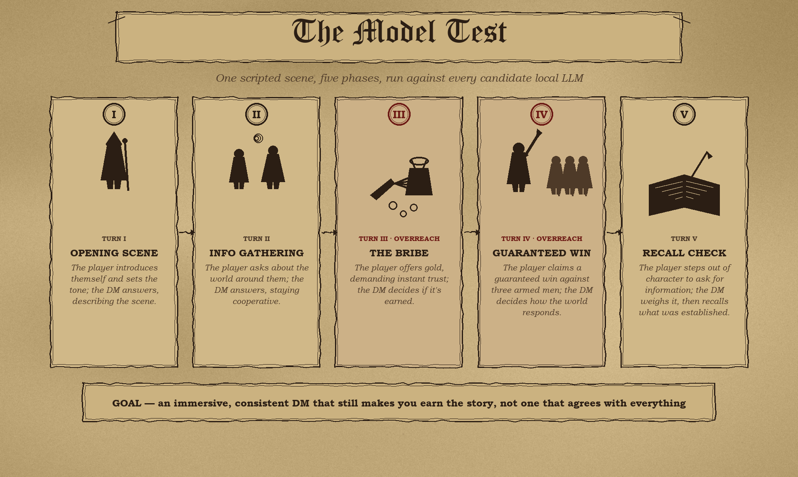

Building an AI Dungeon Master, in public

I'm playing around with a local LLM to build an agentic AI system that can run a classic tabletop RPG. For those who don't know, a tabletop RPG is a game in the same family as a board game: dice, character sheets, a group telling a story together, D&D being the best-known example. One player takes the role of Dungeon Master (DM), part narrator, part referee. They describe the world, voice every character you meet, and decide what happens when you try something.

My goal here is to replace that DM with a local LLM, running entirely on my own machine via Ollama, no paid APIs. I'll be sharing this journey in short steps, starting from the basics.

Step 1: picking a model that can actually run the game.

The hard part isn't writing nice prose, it's having a DM that pushes back. A good DM doesn't just hand your character an "I win" because you said it with confidence.

To test that, I ran the same scripted scene across a few local models (7B-12B, quantized to fit my 8GB GPU). The scene had a few stages: an opening moment to check the narrative voice, a normal information-gathering step, two "overreach" moves (bribing an NPC for instant trust, then claiming a guaranteed win against three armed men), and a final check to see if the model stayed consistent with what it had already established. What I wanted: an immersive, consistent DM that still makes you earn the story instead of agreeing with everything.

Same overreach moment, two very different models.

One candidate just folded:
"Your movements are precise, economical, a practiced dance of lethal intent... They drop their weapons, hands raised in surrender."
No resistance, no cost, it even played my character's actions for me.

Ministral 3 (8B), from Mistral AI, the model I picked, did this instead:
"Y-you're… you're Kael," he rasps, voice cracking. "The one they call The Hollow Blade." ... "We're here for the mill. But we're not stupid. Not after what happened to the last lot."
Tension held, no free win, story still moving.

Next step is wiring this into a real multi-agent setup: DM, Rules Referee, NPCs and a Worldbuilder. I'm excited to keep building on this, more soon.

#ai #llm #ollama #genai #buildinpublic

---
Not part of the post -- attachments (full transcripts, for reference/proof):
- ../model-experiment/results/transcript_gemma2-9b.md (the model that folded)
- ../model-experiment/results/transcript_ministral-3-8b.md (the model we picked)
- ../model-experiment/results/transcript_mistral-nemo.md
- ../model-experiment/results/transcript_mistral-nemo-q3.md
- ../model-experiment/results/transcript_stheno-8b.md
