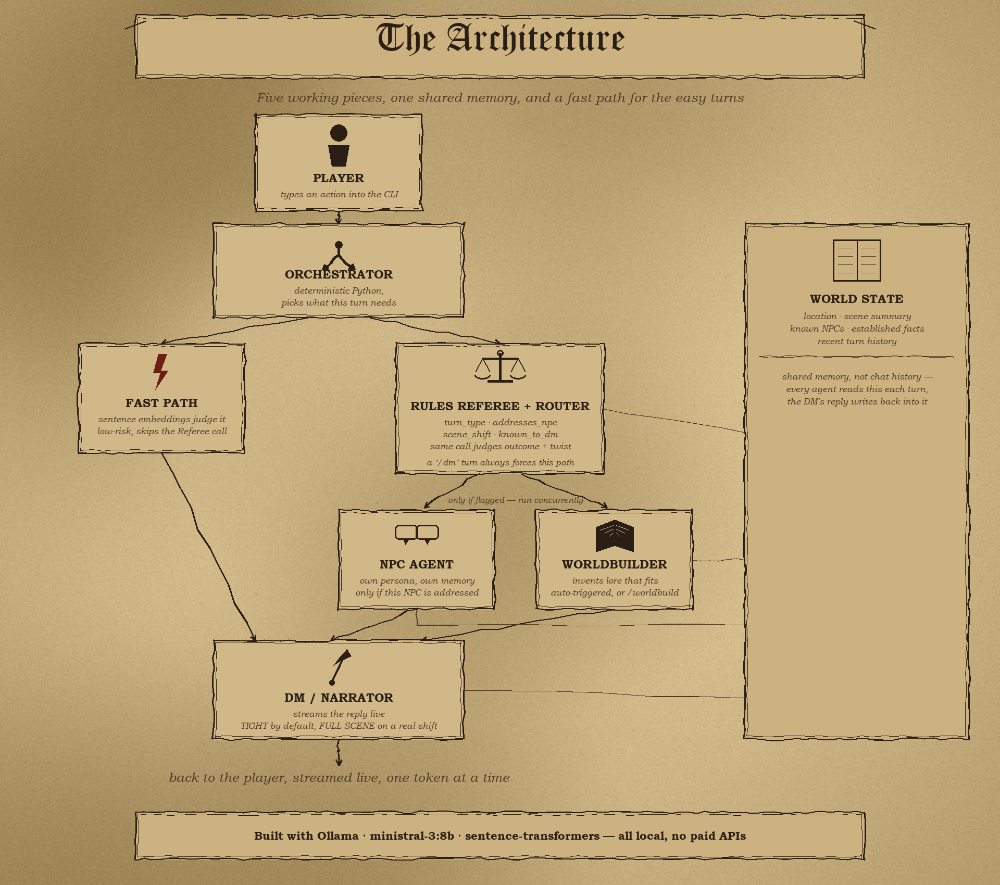

Building an AI Dungeon Master, the architecture

Last time I picked the model. Since then I built the thing it's supposed to run: a small multi-agent pipeline, not one model doing everything.

Here's how a turn actually works. An Orchestrator, plain Python, no model involved, decides what this turn needs. A combined Rules Referee and Router call judges the action and routes it in the same pass: does this involve the NPC, is there lore missing, is the scene changing enough to deserve a fuller description. Only what's flagged gets called, and when more than one thing is needed, those calls run concurrently instead of one after another.

The NPC keeps its own persona and its own memory thread, separate from the main story. The Worldbuilder invents lore on demand now, not only when I ask for it by hand. The DM narrates last, tight by default, and only opens up into a fuller scene when the Referee flags an actual change of place. Everything reads from and writes back into one shared World State, not raw chat history, that's what keeps it all consistent turn to turn.

I also added a fast path: for low-risk turns, sentence embeddings judge the action simple enough to skip the Referee call entirely. I tried a second, smaller local model for this first, it slowed everything down and ignored its own instructions. Embeddings on the CPU turned out to be the cheap, reliable option. There's also a plain "/dm" command for when I want to ask the DM something out of character, instead of guessing it from the sentence.

Next step is the part that actually matters: how good and how trustworthy the DM's narration really is. Having all the pieces wired up is one thing, whether the story it tells is worth reading and whether it still holds the line when pushed is another. More soon.

#ai #llm #ollama #genai #buildinpublic
